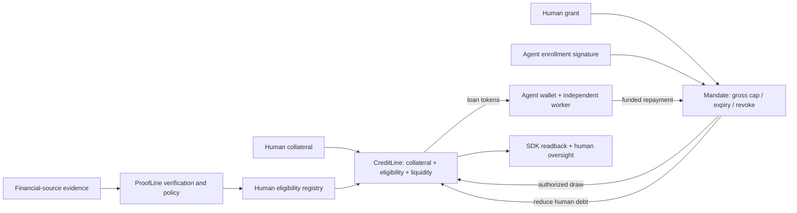

# Judge demo: verified eligibility, human-backed credit, bounded agent authority

This guide packages the existing workflow as a developer integration plus human oversight. It does not add a new lending protocol. The SDK and website provide two ways to inspect the same contracts and events.

## One-minute explanation

A human provides financial-source evidence to ProofLine. Eligibility bounds the human's collateral-backed credit line. The human and a distinct agent consent to a capped, expiring mandate. The agent holds received tokens and signs draws and repayments. The human remains responsible for total debt and can stop future draws.



The loan remains overcollateralized under the demo's assumed 1:1 token value. Repayment reduces principal but does not replenish the current cumulative draw cap. An agent can repay from its cash; the human or another payer can also reduce human debt. If the agent spends its tokens, repayment requires other funds. Returning unspent loan tokens is not revenue.

## Reproducible local evidence

With Node 22.13+, Foundry, root dependencies and contract libraries installed, from the repository root:

```sh
npm run sdk:build
forge build --root contracts
npm test
npm run agent:demo
```

Read `deployments/agent-credit-local.json`. The harness starts its own disposable Anvil RPC on a random loopback port, deploys seven contracts, injects explicitly synthetic eligibility, grants a mandate with separate signatures and starts an independent worker process. No human transaction occurs between the autonomous draw and repayment. Anvil mines periodic empty blocks alongside immediate transaction mining so the worker’s chain-time repayment interval advances without a human transaction.

Check these **actual assertions and fields**, not only the console summary:

1. Confirmed draw and repayment receipts have the independent agent sender and mandate destination.
2. Human debt becomes zero; collateral stays deposited. `sdkObservationAfterRepayment` reconciles principal to zero while gross drawn remains 20 pUSD. The later explicit renewal creates a new 50 pUSD grant with zero gross draws; `sdkObservation` records that final revoked grant. Repayment itself never resets the cap.
3. A draw over the cap is a mined revert. A draw after human revocation is a second mined revert.
4. Worker regression tests deliberately omit confirmed history and check that no financial transaction is sent. SDK regression tests reject a human signer, incomplete history and excess gross draw requests, and allow repayment after revocation.
5. `network`, `chainId`, `authenticReclaim`, `creCliDelivery`, `meraOnboarding` and `rpcRunningAfterScript` identify the environment and unproven stages.

The artifact contains public receipt evidence and SDK observations with block/hash/time. The demo also runs the shipped read-only example against the compiled package export; `compiledSdkExampleVerified` records that check. No keys are included. The RPC stops on exit; local hashes must not be linked to a public explorer. Saved timestamps and hashes describe that run, not current live state. A rerun replaces the artifact with its own evidence.

The authenticated CRE fixture simulation is a **separate** acceptance check:

```sh
# Terminal 1, repository root
npm run eligibility:fixtures
# Terminal 2, after CRE CLI login
npm run cre:simulate:fixture
```

This executes synthetic fixtures with writes disabled. It is not a genuine source proof, public registry delivery or a DON deployment. Local simulation can contact Chainlink settings/RPC services and is not fully offline. See `docs/CRE-REVIEW-2026-10-08.md` and `docs/ELIGIBILITY.md` for evidence and local report approval/delivery operations.

## Website walkthrough

- `/`: one visual journey, SDK and oversight entry points, evidence status, then the clearly separate existing manual testnet demo.
- `/developers`: package build/pack commands, read example, runnable local demo and acceptance gates. No sign-in required.
- `/agent-credit`: human eligibility receipt, collateral, explicit grant/revoke and independent-agent monitoring. Fresh manifest absent → financial controls disabled. No simulated transactions, placeholder addresses or invented worker-online badge.

On a configured public stack, show the paired CreditLine/mandate events with block/log positions, agent cash, attributed principal, total human debt and the unchanged gross counter after repayment. A mismatched history makes attribution unknown and blocks worker/SDK actions. It does not hide the human's contract debt.

Do not label a manual-attestation deployment as the evidence-backed agent stack. Do not count a token approval as a repayment, a submitted hash as success, or a chain event as proof a worker is presently online. Human passkey UI availability is not actual device acceptance.

## Public acceptance gates before stronger claims

- Review the real Reclaim provider and source fields, obtain a fresh genuine test-mode source proof and verify wallet/domain/freshness bindings. Test-mode source data is integration evidence, not real earnings.
- Fund a public-testnet signer and deploy the fresh, correctly pinned evidence-mode seven-contract stack. Record chain, addresses, deployment-covering block and confirmed receipts. Keep raw proofs and signer secrets off the browser.
- Execute the locally approved report delivery path, verify the exact receiver/registry state and label its centralized signer trust. Do not call direct local delivery decentralized DON execution.
- Complete real Mera device/passkey acceptance and then an unattended public-chain agent draw/repay run. Demonstrate cap and revoke behavior with actual receipts.
- Rehearse the exact judge URL on a fresh desktop/mobile browser. Existing manual explorer links and local saved receipts are separate evidence sets.

Oracle identity is not a borrower credit reputation system. Eligibility is attached to the human financial source, not an agent score. Source verification can reveal raw facts to the verifier; the current design does not provide privacy from that verifier. Revocation cannot recover tokens already held by an agent. No SDK-memory cap replaces the on-chain cap.

## Submission wording

**Use now:** “Our SDK and oversight UI wrap a tested human-backed agent mandate. A separate worker signs draws and repayments on disposable Anvil with synthetic eligibility; local CRE fixture execution is verified separately.”

**Use after the corresponding gates pass:** describe the specific authentic source integration, public deployment and autonomous public receipts, with links. Keep the missing gates explicit until they pass.

The paid-resource/business-revenue scenario remains a future adapter. It is not part of this demo. There are no sponsor economics, new liquidity markets, streaming payments or reputation scores in this implementation.
